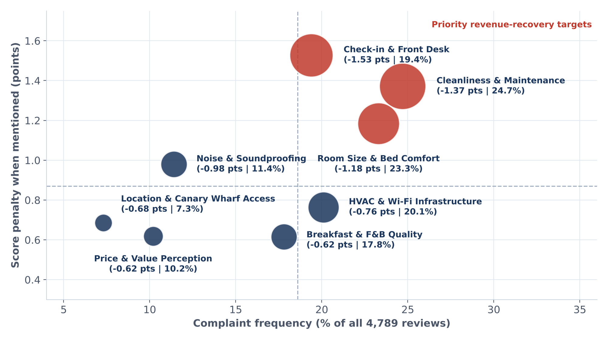
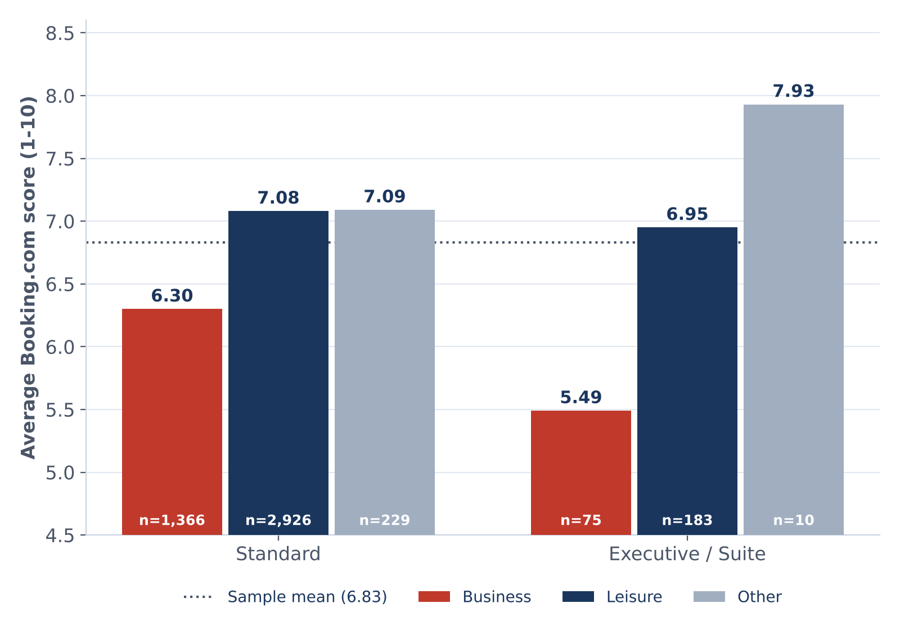
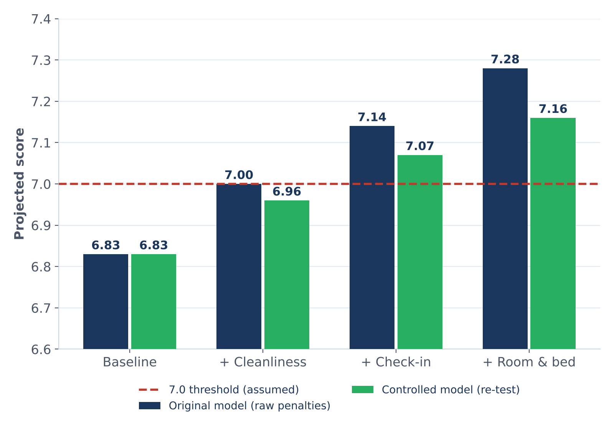

# Fix Three Things, Win Back the Score: Guest-Review Revenue Diagnostics for Britannia International Hotel Canary Wharf

> **Executive Thesis:** Across 4,789 Booking.com reviews, Britannia International Hotel Canary Wharf records an unweighted sample mean of **6.83** (ranking **21st lowest out of 1,492 European hotels** against a dataset median of **8.5**). Nearly half of all reviews (**49.5%**) cite just three operational friction points: **Cleanliness & Maintenance**, **Check-in & Front Desk**, and **Room Size & Bed Comfort**. Cutting complaints in these three drivers by 50% lifts the predicted guest rating by **+0.34 to +0.46 points**, pushing the property clearly past the **7.0 OTA visibility threshold** and protecting rate-fence integrity for high-paying corporate guests.

---

## Table of Contents
1. [The Commercial Story: Why a 6.83 Score Costs Revenue](#1-the-commercial-story-why-a-683-score-costs-revenue)
2. [Methodology & Machine Learning Pipeline](#2-methodology--machine-learning-pipeline)
3. [Key Diagnostic Insights](#3-key-diagnostic-insights)
4. [Commercial Action Plan & Target KPIs](#4-commercial-action-plan--target-kpis)
5. [Validation, Epistemic Humility & Limitations](#5-validation-epistemic-humility--limitations)
6. [Repository Structure & How to Run](#6-repository-structure--how-to-run)
7. [About the Author](#7-about-the-author)

---

## 1. The Commercial Story: Why a 6.83 Score Costs Revenue

In online hotel distribution, review scores are not vanity metrics. They act as digital storefronts, search-filter gates, and pricing power engines. On platforms like Booking.com, travelers routinely filter search results at **7.0+**. Falling below that line shrinks organic impressions, forces heavier reliance on discounting to fill rooms, and erodes Average Daily Rate (ADR).

Located in London's Canary Wharf financial district, **Britannia International Hotel** sits in a prime corporate and leisure corridor. Yet across **4,789 scraped Booking.com reviews** (August 2015 to August 2017, 80% UK reviewers), the property averages **6.83** on a 2.5 to 10 scale (compared to an official listed Booking.com score of **7.1** at the time of scraping).

Instead of treating thousands of free-text complaints as an overwhelming wall of noise, this project approaches guest feedback like a revenue management audit:
* **Which specific failures actually move the rating needle?**
* **Which customer segments are paying premium rates for an underwhelming experience?**
* **How much score recovery can management realistically capture by fixing the top three operational bottlenecks?**

---

## 2. Methodology & Machine Learning Pipeline

Because the public Kaggle dataset (515,738 reviews across 1,492 hotels) contains rich text and booking metadata without internal Property Management System (PMS) ADR figures, guest rating serves as a commercial conversion and pricing proxy. The analytical workflow in [`britannia_hotel_revenue_ml_analysis.ipynb`](britannia_hotel_revenue_ml_analysis.ipynb) follows four stages:

1. **Cohort Isolation & Feature Engineering:** Filtered all **4,789 reviews** for Britannia International Hotel Canary Wharf and parsed unstructured booking tags into structured **traveler segments** (Business, Leisure, Other), **room tiers** (Standard vs. Executive/Suite), and **length of stay (LOS)**.
2. **Aspect Extraction & Unsupervised Topic Validation:** Tagged negative reviews across **8 operational drivers** using domain-specific keyword rules, then cross-checked complaint clusters using **Non-Negative Matrix Factorization (NMF)** topic modeling to ensure themes emerged organically from the corpus.
3. **Econometric & ML Control Modeling:**
   * Computed raw **Score Penalty** (mean rating with the complaint minus mean rating without) and **Total Score Drag** (`Frequency x Penalty`).
   * Trained a **Gradient Boosting Regressor** (hold-out test $R^2 = 0.29$; 5-fold cross-validation $R^2 = 0.27$) alongside multivariate **OLS regression** to isolate each driver's partial effect while controlling for segment, room tier, length of stay, and co-occurring complaints.
4. **Counterfactual Recovery Simulation:** Simulated a **50% complaint reduction** across the top three drivers and generated **1,000-iteration bootstrap 95% confidence intervals** to bound expected score recovery.

---

## 3. Key Diagnostic Insights

### Insight 1: Three Operational Drivers Explain 65% of Total Score Drag

Mapping complaint frequency against score penalty reveals a clear priority quadrant in the upper right:

| Operational Driver | Mention Frequency | Score Penalty | Raw Drag | Priority Status |
| :--- | :---: | :---: | :---: | :--- |
| **Cleanliness & Maintenance** | **24.7%** | -1.37 pts | -0.34 pts | **Priority 1 (Highest Total Drag)** |
| **Check-in & Front Desk** | **19.4%** | **-1.53 pts** | -0.30 pts | **Priority 2 (Worst Per-Mention Penalty)** |
| **Room Size & Bed Comfort** | **23.3%** | -1.18 pts | -0.28 pts | **Priority 3 (High Frequency)** |
| HVAC & Wi-Fi Infrastructure | 20.1% | -0.76 pts | -0.15 pts | Secondary Infrastructure |
| Breakfast & F&B Quality | 17.8% | -0.62 pts | -0.11 pts | Secondary F&B |
| Noise & Soundproofing | 11.4% | -0.98 pts | -0.11 pts | Premium-Room Risk |
| Price & Value Perception | 10.2% | -0.62 pts | -0.06 pts | Symptom of Core Friction |
| Location & Canary Wharf Access | 7.3% | -0.68 pts | -0.05 pts | Non-Issue Once Controlled ($p = 0.326$) |

* **Cleanliness & Maintenance** is the single largest drag on the hotel's reputation because nearly **1 in 4 guests (24.7%)** mention it.
* **Check-in & Front Desk** is the most toxic single experience: when queues or service friction happen, they slash the rating by **-1.53 points** on average.
* **Location is not the problem:** Although raw location mentions carry a -0.68 pt gap, multivariate regression shows the controlled partial effect is **-0.096 points ($p = 0.326$)**, statistically indistinguishable from zero. Guests love Canary Wharf access; they penalize the property for room condition and arrival friction.

---

### Insight 2: A Broken Rate Fence Is Alienating Executive Business Guests

Segmenting scores by room tier and trip purpose uncovers a severe commercial vulnerability:

* **Executive / Suite Business travelers** record the lowest satisfaction of any major cohort at **5.49** ($n = 75$), compared to **6.30** for **Standard Business travelers** ($n = 1,366$).
* That **0.81-point gap** (95% CI: **0.36 to 1.23**) means guests paying higher rates for upgraded inventory leave significantly angrier than guests booking base rooms.
* **Why?** Executive business reviews cite **cleanliness issues at 40% vs. 27%** and **room/bed comfort complaints at 36% vs. 22%** compared to standard business stays. In revenue management terms, the hotel's rate fence is broken: it charges a premium tier without delivering differentiated product quality.

---

### Insight 3: Cutting Top-Three Complaints by 50% Lifts the Score Past 7.0

When a guest experiences both a slow check-in and a stained carpet, raw additive math double-counts overlapping penalties. Comparing the naive additive model against the controlled multivariate OLS model provides realistic executive expectations:

* **Baseline Sample Mean:** **6.83**
* **Step 1 (+50% Cleanliness Fix):** Lifts score to **7.00** (raw) / **6.96** (controlled)
* **Step 2 (+50% Check-in Fix):** Lifts score to **7.14** (raw) / **7.07** (controlled)
* **Step 3 (+50% Room & Bed Fix):** Lifts score to **7.28** (raw) / **7.16** (controlled)

Under the strict controlled model, fixing cleanliness alone gets close (**6.96**), **but executing all three operational fixes together is required to push the property decisively past the 7.0 OTA visibility line to 7.16** (total controlled lift of **+0.34 points**, bootstrap 95% CI: **+0.32 to +0.36**).

---

## 4. Commercial Action Plan & Target KPIs

To translate these diagnostics into hotel operations and commercial management, the executive deck proposes three targeted interventions paired with trackable monthly KPIs:

| Target Area | Operational Intervention | Commercial Target KPI |
| :--- | :--- | :--- |
| **1. Cleanliness & Maintenance** | Institute digital preventive maintenance logs, supervisor room-ready sign-offs, and phased carpet/bathroom refreshes starting on Executive floors. | Reduce cleanliness mention rate from **24.7% to below 12%** |
| **2. Check-in & Front Desk** | Roll out mobile pre-arrival registration, a dedicated corporate/loyalty express lane, and peak shift reinforcement between **3:00 PM and 7:00 PM**. | Reduce check-in mention rate from **19.4% to below 10%** |
| **3. Room Comfort & Rate Fence** | Execute a mattress/topper replacement program and audit Executive room inventory and amenities so premium pricing matches physical product standards. | Lift Executive Business mean score from **5.49 to above 6.30** |

*(Note: Action items and target KPI thresholds represent commercial management proposals informed by the model outputs.)*

---

## 5. Validation, Epistemic Humility & Limitations

Strong analytics requires separating high-confidence findings from directional signals:

* **High Confidence:** All summary metrics, driver rankings, and simulation outputs reproduce directly from the 4,789 cleaned reviews, and the top-three driver order holds after controlling for segment, room tier, length of stay, and overlapping complaints.
* **Medium Confidence:** The Executive business penalty (**5.49**, $n = 75$) is directionally clear but carries a wider confidence interval due to sample size. Likewise, crossing **7.0** depends on whether management benchmarks against the scraped unweighted mean (**6.83**) or Booking.com's weighted platform score (**7.1**).
* **Methodological Limits & Next Steps:**
  * *Keyword Rules vs. Context:* Rule-based tagging can capture generic mentions (e.g., "staff" or "queue"). Upgrading to fine-tuned transformer aspect-based sentiment models (e.g., DeBERTa) would sharpen precision.
  * *Observational Data:* Cross-sectional review scores show strong association rather than randomized causality. Running a **single-floor renovation and express check-in pilot** would validate true causal lift.
  * *Revenue Quantification:* Joining review trends with internal PMS ADR/occupancy logs and STR competitive set benchmarks would convert every **+0.10 rating point** directly into RevPAR gain.

---

## 6. Repository Structure & How to Run

* `images/01_revenue_impact_matrix.png` : Frequency vs. score penalty matrix
* `images/02_room_tier_rate_fence_diagnostic.png` : Standard vs. Executive/Suite segment scores
* `images/03_score_recovery_simulation.png` : Raw vs. controlled counterfactual score lift
* `Britannia_Guest_Experience_Revenue_Report_2.pdf` : 10-slide executive presentation (PDF)
* `Britannia_Guest_Experience_Revenue_Report_2.pptx` : Editable PowerPoint slide deck (PPTX)
* `britannia_hotel_revenue_ml_analysis.ipynb` : Full Python ML, NMF, OLS & bootstrap notebook
* `README.md` : Project documentation and executive summary

### Reproducing the Analysis
1. Clone the repository: `git clone https://github.com/Sali-analytics/hotel-review-ml-revenue-diagnostics.git && cd hotel-review-ml-revenue-diagnostics`
2. Install required Python libraries: `pip install pandas numpy matplotlib seaborn scikit-learn statsmodels jupyter`
3. Download the [515K Hotel Reviews Data in Europe](https://www.kaggle.com/datasets/jiashenliu/515k-hotel-reviews-data-in-europe) dataset (`Hotel_Reviews.csv`) from Kaggle, place it in the project directory, and run [`britannia_hotel_revenue_ml_analysis.ipynb`](britannia_hotel_revenue_ml_analysis.ipynb).

---

## 7. About the Author

**Hosea Ngo Sali, CRMA**  
*M.A. International Tourism Development | B.Sc. Business Administration | Certified Revenue Management Analyst (CRMA)*  
*Location:* Germany  

I specialize in bridging hospitality commercial strategy, revenue management, and applied machine learning. My work focuses on turning unstructured guest feedback, OTA distribution data, and operational metrics into clear, quantifiable pricing and product decisions.

* **Core Domains:** Hospitality Revenue Management, Commercial Strategy, OTA Distribution & Conversion, Guest Experience Diagnostics, Rate-Fence Optimization
* **Technical Toolkit:** Python (pandas, scikit-learn, statsmodels), Natural Language Processing (NLP & Topic Modeling), Predictive Modeling, Econometric Simulation, Executive Data Storytelling
* **Portfolio & Code:** [github.com/Sali-analytics](https://github.com/Sali-analytics)
